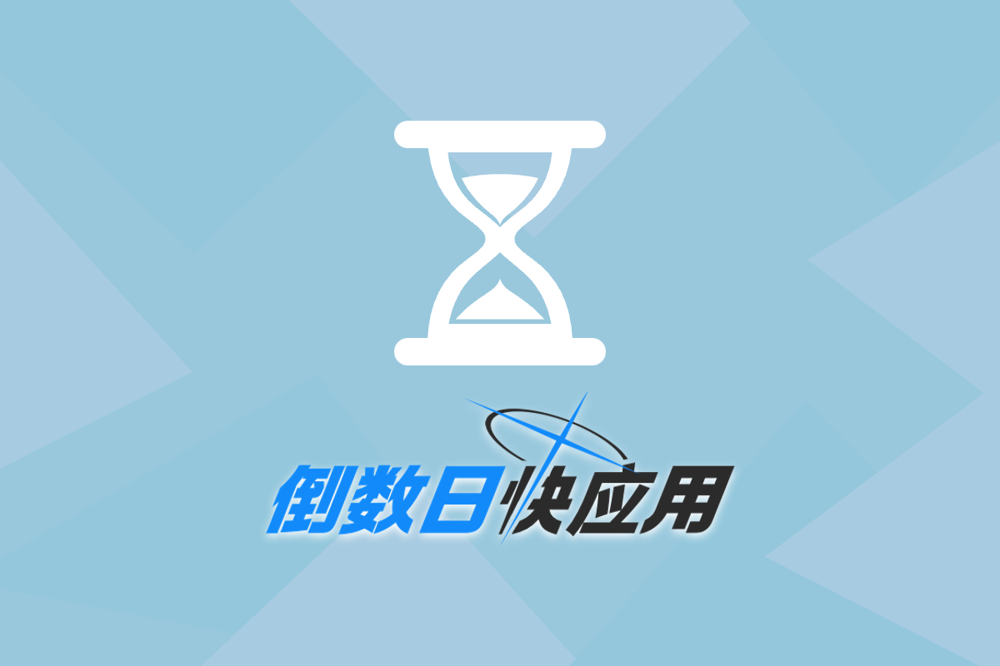
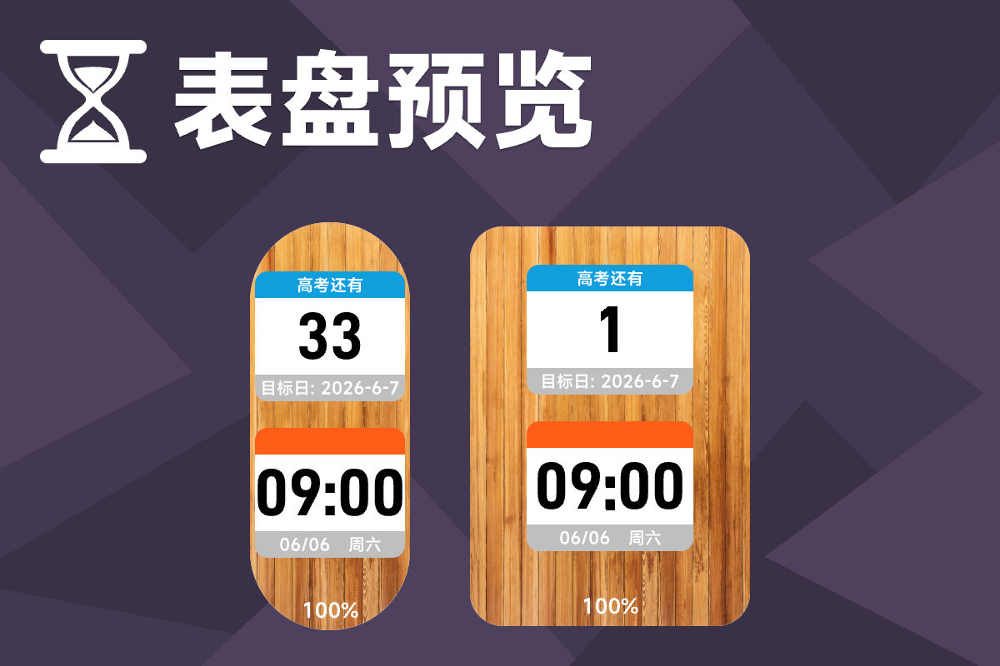
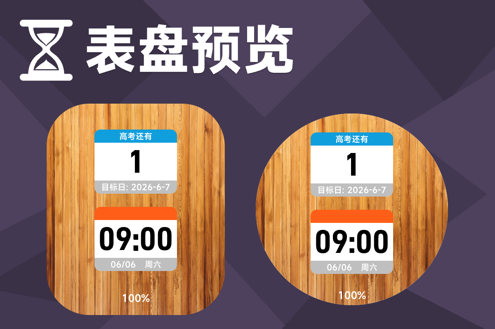

<p align="center">
  
</p>
<p align="center">面向小米 / Redmi Vela 穿戴设备的倒数日联动表盘。</p>

## 功能

- 联动[倒数日快应用](https://github.com/sf-yuzifu/daymatter)，展示主事件名称、目标日期、倒计时与已过去天数。
- 支持计入起始日，当天显示“今天”；没有有效主事件时显示每年 6 月 7 日的高考倒计时。
- 显示时间、日期与电量，提供胶囊 / 方形 / 圆形屏幕布局。
- 通过 [AstroBox 配套插件](https://github.com/sf-yuzifu/Daymatter-AstroBox-Plugin)管理快应用中的主事件与自定义背景。
- 支持背景切换、恢复设备默认背景，以及异常图片回退与重试。
- 创建与亮屏时检查联动数据，亮屏期间每 5 秒检查事件和背景引用，熄屏暂停。

## 预览

<p align="center">
  
  
</p>

实际表盘内容随主事件与背景设置变化。

## 使用

安装对应设备的表盘包和倒数日快应用，在快应用或配套插件中将事件“设为表盘主事件”。该设置与快应用首页展示、置顶和排序独立。

自定义背景通过配套插件选图、预览并上传；快应用保存后，表盘自动读取。快应用“关于”页可恢复默认背景，表盘随之恢复设备自带背景。

主事件由 `date.txt` 提供，格式为 `名称,YYYY-MM-DD,true/false`；`background.txt` 提供当前背景文件名。表盘优先读取 `/data/quickapp/files/com.yzf.daymatter/`，接口打不开时尝试 `/data/files/com.yzf.daymatter/`。

农历和年度重复事件使用快应用导出的公历发生日。应用退出期间不保证年度日期后台更新，重新打开快应用后维护。表盘按天显示，超过 9999 天时在目标日说明超限。

## 设备适配

| 设备 | 构建目标 | 布局尺寸 |
| --- | --- | --- |
| 小米手环 9 | `band9` | 192×490 |
| 小米手环 10 / NFC | `band10` | 212×520 |
| 小米手环 11 / NFC | `band11`（共用手环 10 包） | 212×520 |
| 小米手环 9 Pro | `band9pro` | 336×480 |
| 小米手环 10 Pro | `band10pro` | 336×480 |
| Redmi Watch 6 | `redmiwatch6` | 432×514 |
| Xiaomi Watch S4 | `s4` | 466×466 |
| Xiaomi Watch S5 46mm | `s5_46` | 480×480 |
| Xiaomi Watch S5 41mm | `s5_41` | 466×466 |

S4 玄戒版及 S4 41mm 发布时映射到普通 S4 包；S5 41mm 复用 S4 布局与素材，使用独立编译包。手环 11 共包及 S5 41mm 安装已实机验证。Redmi Watch 5 暂不支持，其他设备兼容性以实际型号和固件验证为准。

## 开发

需要 Python 3，编译安装包使用 **EasyFace 4.23**。在仓库根目录执行：

```powershell
python -m pip install -r requirements.txt
python tools/build.py          # 生成正式工程与设备预览
python tools/build.py --debug  # 生成调试工程，供回归与诊断使用
python tools/test.py           # Lua 5.4 逻辑及模拟 UI 回归
python tools/test_build.py     # 构建、资源清理与预览回归
python tools/build.py --compiler "<EasyFace 4.23目录>\Compiler.exe"
```

生成工程位于 `build/<目标>/daymatter.fprj`，安装包位于 `dist/daymatter-<目标>.face`。默认表盘 ID 为 `979825266002`、发布版本为 `1`，可通过 `--id` / `--version` 指定；构建脚本会同步写入包头。

指定设备时加 `--device band9pro` 等参数；加 `--debug` 后生成独立的 `-debug` 工程及安装包，异常时显示文件路径与尺寸诊断信息。正式包成功生成后才更新 `dist/`。

源码位于 `src/`，共用素材位于 `assets/`，设备素材位于 `devices/`。修改源文件后重新生成工程，`build/` 和 `dist/` 均为构建产物。

[设备配置](devices.json)统一管理布局、字体、资源、预览形状及 EasyFace DeviceType；`extends` 继承配置，`packageAlias` 复用安装包。预览随构建生成，也可运行 `python tools/previews.py` 单独更新。

## 文档与反馈

- [快应用使用与开发说明](https://github.com/sf-yuzifu/daymatter#readme)
- [表盘文件接口](https://github.com/sf-yuzifu/daymatter/blob/main/docs/watchface-interface.md)
- [背景图片与分片传输](https://github.com/sf-yuzifu/daymatter/blob/main/docs/background-transfer.md)
- [设备配置与资源复用](devices.json)
- [日期与事件逻辑](src/logic.lua)、[界面与文件联动](src/daymatter.lua)

欢迎提交 Issue / PR。问题反馈请附设备型号、固件、表盘与快应用版本、复现步骤，以及日志或截图；联动问题请同时注明插件和 AstroBox 版本。

## 致谢

感谢 Xiaomi Vela 与 EasyFace 提供的表盘开发支持，以及参与设备适配和实机验证的用户。
